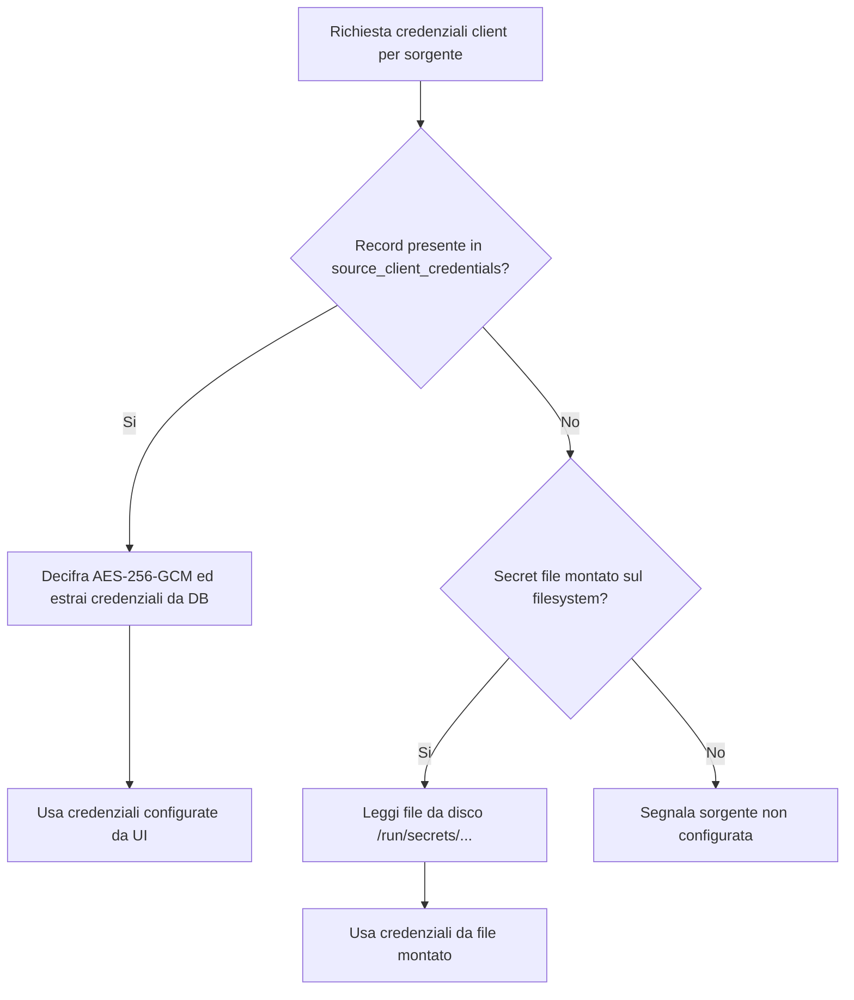
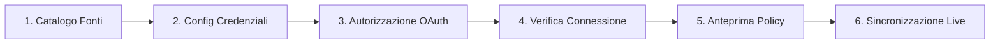

# Specifiche Tecniche di Progetto: Fase B — Architettura Wizard, Sicurezza Credenziali e Connettori

> **Documento di Progettazione Architetturale**  
> **Data:** 12 ottobre 2026  
> **Stato:** Approvato per implementazione (Fase C)  
> **Riferimenti normativi interni:** [`docs/ARCHITETTURA.md`](docs/ARCHITETTURA.md), [`docs/SICUREZZA.md`](docs/SICUREZZA.md), [`docs/CONNETTORI.md`](docs/CONNETTORI.md), [`docs/GMAIL_OAUTH_SETUP.md`](docs/GMAIL_OAUTH_SETUP.md).

---

## 1. Catalogo Modulare dei Connettori

### 1.1 Modello di Dominio per i Descrittori di Fonte
Per superare l'accoppiamento rigido e consentire a GBrain di presentare un catalogo unificato ed estensibile di sorgenti, l'architettura introduce il modello `SourceDescriptor` all'interno di [`backend/src/gbrain/domain/connectors.py`](backend/src/gbrain/domain/connectors.py).

Ogni sorgente è rappresentata da un descrittore immutabile con i seguenti attributi:

- **`id`**: Identificatore alfanumerico univoco (slug) della sorgente (`gmail`, `google_drive`, `google_calendar`, `immich`, `synology`, `local_documents`, `github`, `chatgpt_export`, `omniroute`).
- **`name`**: Nome visualizzato per gli operatori (es. "Google Gmail", "Google Drive", "Immich Foto & Video").
- **`description`**: Breve spiegazione dello scopo operativo e del tipo di dati estratti.
- **`icon`**: Identificatore del simbolo/icona SVG renderizzato dalla UI.
- **`category`**: Categoria funzionale dell'origine (`email_communications`, `cloud_storage`, `media_photos`, `local_storage`, `developer_code`, `conversations_ai`, `networking`).
- **`auth_method`**: Metodo di autenticazione richiesto (`oauth2_authorization_code`, `api_token_header`, `bearer_token`, `filesystem_path`, `archive_upload`, `none`).
- **`status`**: Stato dell'integrazione (`fully_available`, `coming_soon`, `planned`).
- **`test_available`**: Booleano che indica se il connettore implementa una procedura automatica di diagnostica o ping (`test_connection`).
- **`sync_capabilities`**: Struttura `ConnectorCapabilities` che dichiara massimali di paginazione, supporto incrementale, riconciliazione e budget.
- **`config_schema`**: JSON Schema dichiarativo dei campi richiesti per la configurazione (es. file client OAuth o API key).
- **`import_policies`**: Schema delle policy di ingestione configurabili (finestra temporale, limiti di elementi, budget richieste).

### 1.2 Registro Ufficiale delle Fonti (Catalogo)
Il catalogo viene registrato in memoria e reso interrogabile tramite API. La configurazione dei connettori è la seguente:

1. **`gmail`**:
   - Stato: `fully_available`
   - Categoria: `email_communications`
   - Metodo di autenticazione: `oauth2_authorization_code`
   - Scope esatto: `https://www.googleapis.com/auth/gmail.readonly`
   - Invariante di perimetro: Solo etichetta `SENT` (email inviate)
   - Supporto test e preview: Attivo.
2. **`google_drive`**:
   - Stato: `coming_soon`
   - Categoria: `cloud_storage`
   - Metodo di autenticazione: `oauth2_authorization_code`
3. **`google_calendar`**:
   - Stato: `coming_soon`
   - Categoria: `email_communications`
   - Metodo di autenticazione: `oauth2_authorization_code`
4. **`immich`**:
   - Stato: `coming_soon`
   - Categoria: `media_photos`
   - Metodo di autenticazione: `api_token_header`
5. **`synology`**:
   - Stato: `coming_soon`
   - Categoria: `local_storage`
   - Metodo di autenticazione: `bearer_token`
6. **`local_documents`**:
   - Stato: `coming_soon`
   - Categoria: `local_storage`
   - Metodo di autenticazione: `filesystem_path`
7. **`github`**:
   - Stato: `coming_soon`
   - Categoria: `developer_code`
   - Metodo di autenticazione: `bearer_token`
8. **`chatgpt_export`**:
   - Stato: `coming_soon`
   - Categoria: `conversations_ai`
   - Metodo di autenticazione: `archive_upload`
9. **`omniroute`**:
   - Stato: `coming_soon`
   - Categoria: `networking`
   - Metodo di autenticazione: `api_token_header`

---

## 2. Modello di Sicurezza e Persistenza Credenziali

### 2.1 Tabella `source_client_credentials`
Per consentire il caricamento e la configurazione dinamica dei client OAuth direttamente dall'interfaccia utente (senza richiedere preventivamente il montaggio di file sul filesystem host), viene introdotta la tabella dedicata `source_client_credentials` in [`backend/src/gbrain/domain/models.py`](backend/src/gbrain/domain/models.py).

```sql
CREATE TABLE source_client_credentials (
    id UUID PRIMARY KEY DEFAULT gen_random_uuid(),
    owner_id UUID NOT NULL REFERENCES owner_accounts(id) ON DELETE CASCADE,
    source_kind VARCHAR(64) NOT NULL,
    auth_method VARCHAR(32) NOT NULL DEFAULT 'oauth2',
    client_type VARCHAR(32) NOT NULL DEFAULT 'web',
    client_id VARCHAR(512),
    encrypted_credentials BYTEA NOT NULL,
    format_version INTEGER NOT NULL DEFAULT 1,
    configured_redirect_uri VARCHAR(512),
    is_active BOOLEAN NOT NULL DEFAULT TRUE,
    created_at TIMESTAMPTZ NOT NULL DEFAULT now(),
    updated_at TIMESTAMPTZ NOT NULL DEFAULT now(),
    CONSTRAINT uq_source_client_owner_kind UNIQUE (owner_id, source_kind)
);

CREATE INDEX ix_source_client_credentials_owner_id ON source_client_credentials(owner_id);
```

### 2.2 Cifratura Autenticata a Riposo (AES-256-GCM)
Le credenziali sensibili del client (`client_secret`, chiavi private o configurazioni confidenziali) non vengono mai persistite in chiaro su PostgreSQL.

1. **Algoritmo Crittografico**: AES-256-GCM (Galois/Counter Mode con tag di autenticazione a 128 bit).
2. **Formato Payload Binario**:
   - Byte 0: `format_version` (fissato a `0x01`).
   - Byte 1..12: Nonce casuale CSPRNG a 96 bit generato con `secrets.token_bytes(12)`.
   - Byte 13..N: Ciphertext cifrato con tag GCM integrato in coda.
3. **Associated Authenticated Data (AAD)**:
   - Contesto crittografico fisso: `b"gbrain:source-client-credentials:v1"`.
   - Garantisce che un ciphertext non possa essere scambiato o manipolato tra record o scopi applicativi differenti.
4. **Gestione Chiave di Cifratura**:
   - Se configurata, viene letta la chiave da `GBRAIN_SOURCE_CREDENTIALS_ENCRYPTION_KEY_FILE` (32 byte esadecimali).
   - In alternativa, viene derivata deterministicamente tramite HKDF (RFC 5869) con SHA-256 a partire da `Settings.auth_secret`:
     - Salt: `b"gbrain:credentials-hkdf-salt:v1"`
     - Info: `b"gbrain:source-client-credentials:v1"`
     - Output: 32 byte ad alta entropia.
5. **Zero Leak Protection**:
   - Gli endpoint di lettura (`GET`) mascherano sempre il secret, restituendo solo un'anteprima del `client_id` (o la presenza del secret come booleano).
   - I filtri di logging escludono sistematicamente il campo `client_secret` e qualsiasi stringa JSON grezza caricata.

### 2.3 Retrocompatibilità e Gerarchia di Risoluzione
L'architettura garantisce piena retrocompatibilità con i secret file montati (`/run/secrets/gmail_oauth_client_secret.json` o variabile `GBRAIN_GMAIL_OAUTH_CLIENT_SECRET_FILE`):



### 2.4 Parser e Validazione Upload JSON
L'endpoint di caricamento delle credenziali accetta i file JSON generati direttamente da Google Cloud Console:

1. **Limitazione Dimensione**: Massimo 64 KB per prevenire tentativi di DoS o esaurimento memoria.
2. **Supporto Formati**:
   - Formato standard **Applicazione Web**:
     `{"web": {"client_id": "...", "client_secret": "...", "redirect_uris": [...]}}`
   - Formato **Applicazione Desktop / Installed**:
     `{"installed": {"client_id": "...", "client_secret": "...", "redirect_uris": [...]}}`
   - Formato dizionario piatto:
     `{"client_id": "...", "client_secret": "..."}`
3. **Validazione Pydantic**: Verifica obbligatoria che `client_id` e `client_secret` siano stringhe non vuote e conformi agli standard RFC.

### 2.5 Migrazione Alembic
- Script: `backend/migrations/versions/20261012_0004_source_client_credentials.py`.
- Revisione base (`down_revision`): `20261011_0003`.
- Assicura singola head lineare nel grafo di migrazione, operazione idempotente e reversibile.

---

## 3. Strategia Google OAuth su LAN (`http://10.0.0.105:8185`)

### 3.1 Restrizione Ufficiale Google OAuth 2.0
In base alla RFC 8252 e alle norme di conformità di Google Identity Services per i client OAuth di tipo *Web Application*:

1. **Regola degli Authorized Redirect URIs**:
   - Google impone l'uso esclusivo del protocollo **HTTPS** su domini TLD validi (es. `https://my-domain.org/callback`).
   - L'unica eccezione ammessa per il protocollo HTTP non cifrato è l'indirizzo di loopback: `http://localhost` oppure `http://127.0.0.1` (con qualsiasi porta).
   - **Google VIETA espressamente gli indirizzi IP privati non-loopback** (come `http://10.0.0.105:8185/...` o `http://192.168.1.100:...`). La Google Cloud Console rifiuta il salvataggio con l'errore:  
     `"Invalid Redirect: must use a domain name (not an IP address) or localhost"`.

### 3.2 Gestione Dinamica nel Wizard di GBrain
Il Wizard analizza l'URL da cui l'utente sta navigando:

1. **Rilevamento Automatico**:
   - L'endpoint `GET /api/sources/{source_id}/status` esamina l'host effettivo (`request.base_url` o `Settings.public_url`).
   - Se l'host è un indirizzo IP privato (es. `10.0.0.105`), calcola il flag `lan_ip_detected: true`.
2. **Avviso Contestuale nel Wizard (Step 2)**:
   - Se viene rilevato un IP privato HTTP, viene visualizzato un pannello informativo chiaro con le modalità ammesse:
     - **Modalità 1 — Hostname LAN con Reverse Proxy HTTPS (Consigliata per HomeLab)**:  
       Utilizzare un nome DNS locale o un dominio wildcard con certificato TLS valido (es. tramite Caddy, Traefik o Nginx con Let's Encrypt o certificato locale affidabile), ad esempio `https://gbrain.local:8185/api/sources/gmail/oauth/callback` o `https://10-0-0-105.nip.io:8185/...`.
     - **Modalità 2 — Accesso tramite Localhost / Tunnel SSH**:  
       Se l'utente esegue il browser dalla macchina host o apre un tunnel SSH verso il server (`ssh -L 8185:localhost:8185 root@10.0.0.105`), aprendo `http://localhost:8185` nel browser Google consentirà `http://localhost:8185/api/sources/gmail/oauth/callback` come loopback autorizzato.
     - **Modalità 3 — Configurazione Custom Callback URI**:  
       Il Wizard consente all'utente di specificare manualmente nel modulo il `redirect_uri` registrato nella console Google, supportando scenari con Cloudflare Tunnel o Tailscale Funnel.
3. **Integrità Crittografica della Callback**:
   - Durante l'avvio del flusso OAuth (`begin_oauth`), l'URI di callback prescelto viene associato allo stato crittografico (`GmailOAuthState`) e convalidato al momento della callback per impedire alterazioni di destinazione.

---

## 4. Contratti API FastAPI (REST Endpoints)

Gli endpoint unificati sotto `/api/sources` coordinano l'intero ciclo di vita dei connettori:

### 4.1 Catalogo Fonti
- **`GET /api/sources/catalog`**
  - **Descrizione**: Restituisce l'elenco completo di tutte le fonti gestite (disponibili e future).
  - **Autenticazione**: Sessione proprietario autenticato (`PrincipalDep`).
  - **Risposta (200 OK)**:
    ```json
    {
      "items": [
        {
          "id": "gmail",
          "name": "Google Gmail",
          "category": "email_communications",
          "description": "Sincronizzazione riservata delle email inviate (SENT) con perimetro read-only.",
          "icon": "gmail",
          "auth_method": "oauth2_authorization_code",
          "status": "fully_available",
          "test_available": true,
          "sync_capabilities": {
            "source_kind": "gmail",
            "read_only": true,
            "pagination": true,
            "incremental": true,
            "reconciliation": true,
            "max_page_size": 100,
            "concurrency": 1
          }
        },
        {
          "id": "immich",
          "name": "Immich Foto & Video",
          "category": "media_photos",
          "description": "Asset multimediali, timeline ed eventi geografici da istanza Immich.",
          "icon": "immich",
          "auth_method": "api_token_header",
          "status": "coming_soon",
          "test_available": true
        }
      ]
    }
    ```

### 4.2 Stato Sorgente e Diagnostica LAN
- **`GET /api/sources/{source_id}/status`**
  - **Risposta (200 OK)**:
    ```json
    {
      "source_id": "gmail",
      "configured": true,
      "auth_source": "db",
      "client_id_preview": "987654321...apps.googleusercontent.com",
      "account_connected": false,
      "external_account_id": null,
      "status": "pending_authorization",
      "detected_callback_url": "http://10.0.0.105:8185/api/sources/gmail/oauth/callback",
      "lan_warning": {
        "is_private_ip": true,
        "warning_code": "private_ip_http_unsupported_by_google",
        "message": "Google Cloud Console non accetta indirizzi IP numerici HTTP privati."
      }
    }
    ```

### 4.3 Setup Credenziali Client
- **`POST /api/sources/{source_id}/credentials`**
  - **Richiesta (200/201)**:
    - Payload JSON con `raw_json` o campi separati (`client_id`, `client_secret`, `redirect_uri_override`).
  - **Risposta (200 OK)**:
    ```json
    {
      "source_id": "gmail",
      "client_id": "987654321...apps.googleusercontent.com",
      "client_type": "web",
      "configured_redirect_uri": "http://localhost:8185/api/sources/gmail/oauth/callback",
      "message": "Credenziali salvate con successo e cifrate a riposo."
    }
    ```

### 4.4 Flusso OAuth
- **`POST /api/sources/{source_id}/oauth/authorize`**
  - Avvia la sessione OAuth, registra PKCE verifier e restituisce `authorization_url`.
- **`GET /api/sources/{source_id}/oauth/callback`**
  - Scambia il codice autorizzativo, decifra e valida lo scope, cifra il token finale su DB e reindirizza al Wizard frontend.

### 4.5 Test di Connessione e Anteprima
- **`POST /api/sources/{source_id}/test-connection`**
  - Esegue un probe diagnostico leggero (es. `users.getProfile` per Gmail).
  - Restituisce latenza in ms, account primario verificato ed esito.
- **`GET /api/sources/{source_id}/preview`**
  - Parametri query: `period_after`, `period_before`, `sample_size`.
  - Restituisce stima del volume di elementi e campioni anonimizzati.

### 4.6 Sincronizzazione e Disconnessione
- **`POST /api/sources/{source_id}/sync`**
  - Salva la policy di selezione e accoda il job su Procrastinate.
- **`DELETE /api/sources/{source_id}`**
  - Revoca il token presso il provider esterno e disattiva l'account locale.

---

## 5. Specifiche UI/UX del Wizard a 6 Step

### 5.1 Flusso Utente
Il Wizard guida l'utente attraverso sei passaggi chiari e progressivi:



### 5.2 Dettaglio dei Passaggi

1. **Step 1: Selezione Fonte (Gallery Catalogo)**:
   - Griglia di schede responsive con filtri per categoria.
   - Badge evidenti: *Disponibile* (verde) per Gmail, *Prossimamente* (grigio/blu) per connettori futuri.
   - Cliccando su un connettore pianificato si apre un dialog esplicativo con la roadmap di rilascio.
   - Cliccando su "Gmail" si procede allo Step 2.

2. **Step 2: Configurazione Credenziali (Setup Client OAuth)**:
   - Area di drag & drop per il caricamento diretto del file `credentials.json` scaricato da Google Cloud Console.
   - Box di avviso contestuale per l'indirizzo LAN (con rilevamento automatico e istruzioni sulle alternative ammesse da Google).
   - Guida contestuale a scomparsa con istruzioni passo-passo per Google Cloud Console.
   - Pulsante "Salva credenziali e procedi".

3. **Step 3: Autorizzazione Account (OAuth Handshake)**:
   - Presentazione visiva del perimetro di sicurezza:
     - Solo lettura (`readonly`).
     - Esclusivamente email inviate (`SENT`).
     - Nessun accesso a bozze o email ricevute.
   - Pulsante primario "Autorizza con Google".
   - Gestione del flusso di consenso esterno e ritorno automatico allo step successivo.

4. **Step 4: Verifica Connessione (Diagnostic Check)**:
   - Esecuzione immediata del ping di verifica (`users.getProfile`).
   - Visualizzazione della scheda identità: indirizzo email convalidato e alias di posta rilevati.
   - Selezione e conferma degli alias mittente.
   - Pulsante "Procedi alla configurazione importazione".

5. **Step 5: Configurazione Policy & Anteprima (Preview)**:
   - Selettore intervallo temporale (Preset: 30 giorni, 90 giorni, 1 anno, Personalizzato).
   - Indicatori per limiti di sicurezza: massimale messaggi (default 500) e budget chiamate API.
   - Pulsante "Calcola Anteprima": visualizza il numero stimato di email trovate e una tabella campionaria con data e destinatari per confermare la corretta selezione.

6. **Step 6: Avvio & Monitoraggio Sincronizzazione (Sync Live)**:
   - Riepilogo sintetico dei parametri impostati.
   - Pulsante di lancio sincronizzazione (accoda il job asincrono).
   - Visualizzazione avanzamento in tempo reale con barra percentuale (`processed_items` / `total_items`).
   - Opzione per annullamento morbido (*Cancel Job*) e pulsante per tornare alla visualizzazione fonti.

### 5.3 Caratteristiche Trasversali UX
- **Resumability**: Se l'utente ricarica la pagina o torna dopo il login esterno, il wizard rileva lo stato da backend e ripristina la visualizzazione all'esatto passaggio corrente.
- **Accessibilità & Microinterazioni**: Indicatori di stato ARIA, navigazione completa da tastiera, messaggi di errore privi di stack trace e con azioni di recupero chiare.
